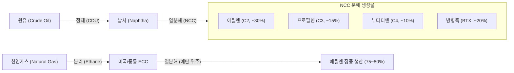

# [석유화학·에너지 데이터 분석 보고서]
## 원유 가격 변동 요인 분석 및 석유화학(납사·에틸렌) 가격 예측 및 생산 최적화 대응 전략

---

### Executive Summary (요약)
본 보고서는 10년 차 에너지·석유화학 전문 수석 데이터 분석가의 관점에서 **(1) 글로벌 원유 가격의 핵심 변동 동인**, **(2) 유가·천연가스·환율·운임 및 석유화학 밸류체인(납사, 에틸렌, 프로필렌, 부타디엔) 간의 상호 작용 메커니즘**, **(3) 시계열 머신러닝 기반 납사/에틸렌 가격 유추(Forecasting) 프레임워크**, 그리고 **(4) 예측치 기반 생산량(가동률 및 원료 믹스) 동적 대응 전략**을 종합적으로 정리한 실무 지침서입니다.

---

## 1. 원유 가격에 영향을 미치는 4대 핵심 요인

원유(Crude Oil: WTI, Brent, Dubai) 가격은 단순한 수급(수요와 공급)뿐만 아니라 복합적인 지정학적·금융적 매크로 변수에 의해 결정됩니다.

```
                    ┌───────────────────────────────┐
                    │      글로벌 원유 가격 동인       │
                    └──────────────┬────────────────┘
           ┌───────────────────────┼───────────────────────┐
           ▼                       ▼                       ▼
   [ 1. 공급 측면 ]         [ 2. 수요 측면 ]        [ 3. 금융/매크로 ]
   - OPEC+ 감산/증산         - 주요국 제조업 PMI     - US Dollar Index(DXY)
   - 미국 셰일오일 리그수     - 계절성(난방/드라이빙) - 금리 및 글로벌 유동성
   - 지정학적 공급 충격      - 에너지 전환/전기차    - 투기적 펀드(CFTC 순매수)
           │                                               │
           └───────────────────────┬───────────────────────┘
                                   ▼
                         [ 4. 정제마진/재고 ]
                         - OECD/EIA 원유 및 석유제품 재고
                         - Crack Spread(크랙 마진)
```

1. **공급 요인 (Supply Dynamics)**
   - **OPEC+ 협의체의 생산 쿼터 및 감산/증산 합의**: 사우디아라비아와 러시아를 필두로 한 생산 정책은 글로벌 공급의 40% 이상을 좌우합니다.
   - **미국 셰일오일(Shale Oil) 생산량 및 시추 리그 수(Baker Hughes Rig Count)**: WTI 가격이 한계비용($50~$65/배럴)을 상회할 때 가동 리그 수가 증가하며 공급 완충 역할을 수행합니다.
   - **지정학적 리스크(Geopolitical Shock)**: 중동 지역 분쟁, 호르무즈 해협/수에즈 운하 등 주요 해상 병목구간(Chokepoints)의 통항 위협, 주요 산유국 대상 국제 제재.

2. **수요 요인 (Demand Dynamics)**
   - **글로벌 거시경제 및 경기 사이클**: 미국·중국·EU의 제조업 구매관리지수(PMI), GDP 성장률. 특히 중국의 석유 수요는 글로벌 증분의 상당 부분을 차지합니다.
   - **계절적 요인(Seasonality)**: 
     - 6~8월(북반구 여름철): 하절기 '드라이빙 시즌(Driving Season)'에 따른 휘발유 수요 폭증.
     - 11~2월(북반구 겨울철): 등유/난방유(Heating Oil) 및 가스 수요 확대.
   - **에너지 전환 및 대체재 속도**: 전기차(EV) 보급 확대, 재생에너지 전환 속도.

3. **금융 및 거시경제 지표 (Financial & Macro Factors)**
   - **미국 달러화 지수 (DXY)**: 원유는 국제 시장에서 미 달러화(USD)로 결제되므로 달러 가치와 통상 **강한 역의 상관관계(Negative Correlation)**를 갖습니다. (달러 강세 시 비달러권 구매력 약화로 유가 하방 압력)
   - **투기적 순매수 포지션 (CFTC Commitments of Traders)**: 원유 선물 시장 내 비상업적 투기 세력의 롱/숏 포지션 쏠림 현상.

4. **재고 및 정제 마진 (Inventory & Refining Margins)**
   - **미국 에너지정보청(EIA) 주간 원유/정제유 재고 변동**: 예상치를 상회하는 재고 증가는 즉각적인 가격 조정 촉발.
   - **크랙 스프레드 (Crack Spread)**: 정유사가 원유 1배럴을 정제해 얻는 제품(휘발유, 경유, 항공유, 납사) 가치의 차이로, 정제 마진이 양호할 때 원유 정제 투입 수요가 유지됩니다.

---

## 2. 석유화학 밸류체인과 가격 전이(Pass-Through) 메커니즘

석유화학 산업(NCC: Naphtha Cracker Center 중심)은 **원유 → 납사(원료) → 기초유분(에틸렌, 프로필렌, 부타디엔) → 합성수지/합성고무**로 이어지는 수직 계열 구조를 가집니다.



### 1) 원유 vs 납사 (원가 전이)
- **전이 시차(Lag Period)**: 원유 가격 변동은 통상 **2주~4주(약 1개월)**의 시차를 두고 납사 현물 가격(CFR Japan 기준)에 반영됩니다. (해상 운송 시간 + 정제/거래 주기)
- **납사 가격 공식**: 일반적으로 싱가포르/일본 복합 원유 수입 가격(COA/현물)에 일정한 Crack 마진(대체로 톤당 원유 배럴 가격 대비 약 7~8배 수준의 환산 계수 적용)이 가산되어 형성됩니다.

### 2) 천연가스(에탄) vs 납사 (글로벌 원가 경쟁력)
- **ECC vs NCC 원가 패리티(Cost Parity)**:
  - 북미/중동은 천연가스에서 분리한 **에탄(Ethane)** 기반 ECC를 통해 에틸렌을 저렴하게 생산합니다.
  - 아시아(한국, 일본, 중국)는 원유 기반 **납사(Naphtha)**를 사용하는 NCC가 주류입니다.
  - **시사점**: 천연가스 가격이 폭락하고 유가가 고공행진하면, 미국 ECC 설비의 에틸렌 단가가 급락하여 아시아 NCC는 심각한 마진 스프레드 압박(Margin Squeeze)에 직면합니다.

### 3) 환율(USDKRW)의 영향
- **원재료 수입**: 납사는 100% 달러 결제로 수입되므로, 환율 상승(원화 약세) 시 원화 환산 제조원가가 급증합니다.
- **제품 수출**: 에틸렌/프로필렌/유도체 역시 달러로 수출하므로 환율 상승이 매출 환산액을 높이지만, 마진 스프레드가 마이너스인 국면에서는 환율 상승이 운전자본 부담을 가중시킵니다.

### 4) 현물 운임지수(SCFI, CCFI, 탱커 운임)와 공급망
- 납사는 대형 유조선(LR/MR 탱커)으로 해상 운송되므로 **탱커 운임(WS, Worldscale)**이 원료 도입 원가(C&F, CIF 프리미엄)를 좌우합니다.
- 다운스트림 폴리머/화학제품 수출 시 **컨테이너 운임지수(SCFI)** 상승은 수출 채산성을 급격히 악화시켜 해외 바이어의 주문 축소(수요 위축)를 유발합니다.

---

## 3. 핵심 모니터링 스프레드(Margin) 지표

석유화학 공장의 수익성과 가동 여부를 판단하는 절대 지표는 **스프레드(Spread = 제품가 - 납사가)**입니다.

| 지표명 | 계산식 | 손익분기점(BEP) 기준치 | 비즈니스 의미 |
| :--- | :--- | :--- | :--- |
| **에틸렌-납사 스프레드** | $P_{Ethylene} - P_{Naphtha}$ | **\$250 ~ \$300 / 톤** | 석유화학의 쌀. \$250 미만 시 NCC 가동률 축소(Run-cut) 검토 |
| **프로필렌-납사 스프레드** | $P_{Propylene} - P_{Naphtha}$ | **\$200 ~ \$250 / 톤** | 자동차/가전용 PP(폴리프로필렌) 기초원료 마진 |
| **부타디엔-납사 스프레드** | $P_{Butadiene} - P_{Naphtha}$ | **\$300 ~ \$400 / 톤** | 타이어/합성고무(SBR/NBR) 원료, 변동성이 매우 큼 |
| **에탄/납사 가격비** | $P_{Ethane} / P_{Naphtha}$ | - | 미국 ECC 대비 아시아 NCC의 상대 원가 경쟁력 지표 |

---

## 4. 납사·에틸렌 가격 유추(Forecasting) 머신러닝 모델링 설계

### 1) 데이터 피처 엔지니어링 (Feature Engineering)
- **타겟 변수(Target)**: $Y_{t+k}^{Naphtha}$ (k주 뒤 납사 가격), $Y_{t+k}^{Ethylene}$ (k주 뒤 에틸렌 가격)
- **설명 변수(Features)**:
  1. **원유 시차 변수**: Dubai, Brent, WTI 주간 평균 가격 및 Lagged Features (t-1주, t-2주, t-4주)
  2. **가스 지표**: Henry Hub, TTF 천연가스 가격, 에탄 가격
  3. **환율 변수**: USD/KRW, USD/CNY (중국 수입 수요 반영)
  4. **운임 변수**: ClarkSea Index, SCFI, 케미컬 탱커(MR/LR) 일일 용선료
  5. **동시 생산물 가격**: 프로필렌, 부타디엔, 벤젠 가격 (수율 결합 생산 특성)
  6. **파생 지표**:
     - 20일/60일 이동평균선(SMA), 지수이동평균(EMA)
     - 역사적 변동성(Historical Volatility)
     - 직전 4주 평균 Crack Spread

### 2) 모델 파이프라인 구성
1. **단기 1~4주 예측**: **VAR (Vector Auto-Regression)** 및 **XGBoost / LightGBM**
   - 유가 변동의 전이 시차가 뚜렷하므로 Feature Importance를 통해 설명력을 확보하고 안정적인 점추정 제공.
2. **중장기 1~3개월 예측**: **Temporal Fusion Transformer (TFT)** 또는 **LSTM-Seq2Seq**
   - 글로벌 경기 지표(PMI), 운임 추세, 계절성 주기를 함께 반영하는 어텐션(Attention) 기반 딥러닝 시계열 모델.

---

## 5. 생산량 변동 및 공장 운용(Operation) 대응 프레임워크

가격 예측 모델의 결과값을 기반으로 공장 운전팀과 기획팀은 다음과 같은 3단계 의사결정을 수행합니다.

```
[ 가격 예측 엔진 ] ──▶ [ 예측 스프레드 산출 ] ──▶ [ 3단계 동적 운영 최적화 ]
                                                    │
                   ┌────────────────────────────────┴────────────────┐
                   ▼                                                 ▼
          [ 1. 가동률 (Run-cut) ]                           [ 2. 원료 혼사 (Co-cracking) ]
          - BEP < $250: 70~80% 감산                         - 납사 비싸면 LPG/프로판 투입 증대
          - BEP > $350: 100% 풀가동                         - 원가 절감 (톤당 $20~$50 절감)
                                                    ▼
                                           [ 3. 분해 가혹도 조절 ]
                                           - 에틸렌 강세: High Severity 운전
                                           - 프로필렌 강세: Low Severity 운전
```

1. **가동률(Operating Rate) 최적화 (Run-cut 전략)**
   - 예측 에틸렌-납사 스프레드가 4주 연속 \$250/톤 하회 예측 시: 공장 가동률을 80% 이하로 선제적 감산.
   - 반대로 스프레드 반등 국면 전환 시: 사전 정기보수(T/A) 일정 연기 및 가동률 100% 정상화.

2. **원료 믹스 최적화 (Co-cracking: 납사 vs LPG/프로판)**
   - NCC는 100% 납사만 투입하는 것이 아니라, 최대 15~30%까지 **LPG(프로판/부탄)**를 혼합 투입(Co-cracking)할 수 있습니다.
   - 여름철 LPG 가격이 납사 대비 85% 이하로 하락할 때 LPG 투입 비중을 극대화하여 에틸렌 생산원가를 방어합니다.

3. **크래커 운전 가혹도(Cracking Severity) 조절**
   - **High Severity (고온 분해)**: 에틸렌 수율을 극대화 (약 32~34%).
   - **Low Severity (저온 분해)**: 프로필렌, 부타디엔, C4 유분 수율을 극대화.
   - 에틸렌 대비 프로필렌/부타디엔 가격 예측치가 우세할 경우 분해 온도를 조절하여 포트폴리오 마진을 방어합니다.

---

## 6. 권장 Seaborn 데이터 시각화 분석 계획

데이터셋 구축 후 실제 현업에서 경영진 보고 및 분석용으로 구현할 추천 Seaborn 차트입니다.

### [기초 시각화]
1. **차트 모델**: `sns.lineplot` (이중 축 시계열 추이)
   - **선정 이유**: 원유 가격과 납사/에틸렌 가격 간의 시간차(Lag)와 스프레드 괴리 추세를 직관적으로 확인.
   - **Dimension & Metric**: X축 = 날짜(Weekly), Y축 = 가격(\$/톤, \$/배럴), Hue = 유종/제품군.
   - **인사이트**: 유가 급변 후 몇 주 뒤에 납사/에틸렌이 반응하는지 전이 시점 포착.
2. **차트 모델**: `sns.boxplot` (월별/분기별 스프레드 분포)
   - **선정 이유**: 분기별 손익분기점(\$250) 하회 빈도와 마진 변동성(Interquartile Range) 파악.
   - **Dimension & Metric**: X축 = 연도-분기(Quarter), Y축 = 에틸렌-납사 스프레드.
   - **인사이트**: 계절적 비수기/성수기 마진 압박 구간 식별.

### [심화 시각화]
1. **차트 모델**: `sns.heatmap` (다변량 시차 상관계수 매트릭스)
   - **선정 이유**: 원유(t, t-1, t-2), 천연가스, 환율, SCFI, 에틸렌, 프로필렌 간의 상관관계를 한눈에 파악.
   - **Dimension & Metric**: X/Y축 = 각 변수 및 시차 변수, Metric = Pearson/Spearman 상관계수.
   - **인사이트**: 에틸렌 가격에 가장 지배적인 선행 지표(Lagged Indicator) 판별.
2. **차트 모델**: `sns.lmplot` (원가 vs 제품가 회귀 추정선 및 신뢰구간)
   - **선정 이유**: 납사 가격 대비 에틸렌/프로필렌 가격의 탄력성(Beta 계수) 및 시장 국면별 산포도 검증.
   - **Dimension & Metric**: X축 = 납사 가격(\$/톤), Y축 = 에틸렌 가격(\$/톤), Hue = 환율 고저 구간(High/Low).
   - **인사이트**: 원가 상승 시 판가 전가가 원활한 '공급자 우위 시장'인지 마진이 축소되는 '수요 위축 시장'인지 구분.

---
*보고서 생성 일자: 2026-11-15*  
*작성: 수석 에너지·석유화학 데이터 분석가*
